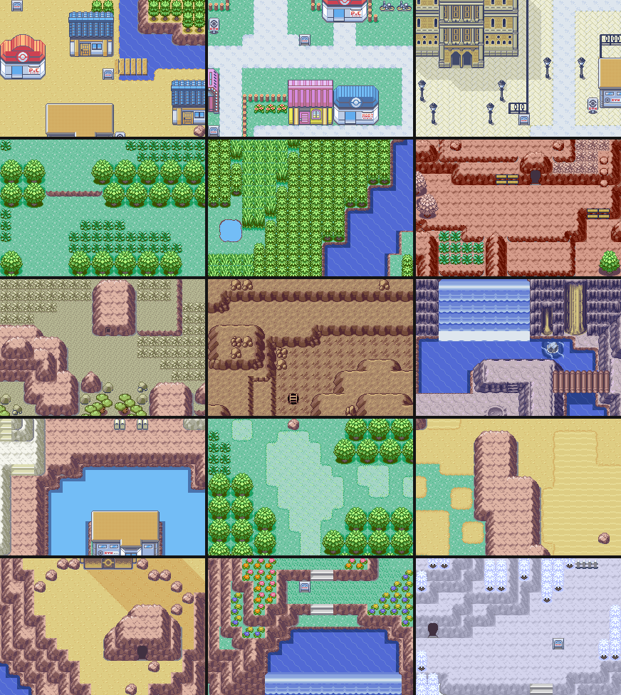

# Sinnoh placeholder art: what we build maps with until final art exists

**Status (Claude, 2026-10-18):** working foundation for map construction. This is **not** final art and **not** approval of any area. The art used is the game's own upstream Emerald-build art, labelled temporary. No donor maps, fan tiles or third-party music are used.

## The rules

1. **Only Emerald-build tilesets.**
   - The FRLG tilesets in the repo compile only in FRLG builds (`#if !IS_FRLG` in `src/data/tilesets/*.h`). Their primary layout also differs: 640 metatiles and 7 palettes, against 512 and 6.
   - So Averon's build can use 75 tilesets today: the 3 primaries (`General`, `Building`, `SecretBase`) and their Emerald secondaries.
   - Using FRLG art would mean porting it, which needs owner approval (manifest row `SN-PH-FRLG-PORT`).
2. **Look different from Averon.**
   - All of Averon's exteriors use `General + Petalburg`, so Sinnoh placeholders avoid that pair.
   - Each biome uses a different secondary tileset (gallery below), so no region-wide "generic carpet".
3. **Build from exact vanilla blocks.**
   - Buildings and features are copied as **stamps** from vanilla maps that already use them. A map block is 16 bits: metatile, collision and elevation.
   - This keeps the parts that are hard to fix later: doors (`MB_ANIMATED_DOOR`, entered by walking into a solid door tile), ledges, shorelines, roof walk-behind rows, and Surf elevation.
   - A stamp from another secondary tileset is accepted only when all of its blocks are shared primary art. The tool refuses anything else.
4. **Fixed now vs replaced later.**
   - **Fixed now:** footprints, collision, elevation, doors and warp positions, exits, palette slots and the 16 × 16 metatile grid.
   - **Replaced later:** surface art, NPC identities and graphics, dialogue, effects, music.
   - The manifest's `replace_when` column names the trigger for each placeholder.

## Biomes (renders of real vanilla maps; one tileset family per biome)



Read left to right, top to bottom:
1. coastal sand town (Dewford)
2. modern city (Mauville)
3. industrial / mining (Rustboro)
4. dense forest (Petalburg Woods)
5. rainy tall-grass route (Route 119)
6. mountain pass (Jagged Pass)
7. volcanic ash (Route 113)
8. cave (Granite Cave)
9. waterfall cave (Meteor Falls)
10. crater lake (Sootopolis)
11. marsh stand-in (Safari Zone)
12. desert (Route 111)
13. summit stand-in (Sky Pillar outside)
14. League (Ever Grande)
15. **snow: a preview recolour only.**

Emerald has **no snow exterior art**. Snowpoint, Routes 216 and 217, and Lake Acuity need either an owner-approved derived palette variant or original art (`SN-PH-SNOW`, `NEEDS_OWNER_ART`).

Two stand-ins carry behaviour that isn't neutral:
- **Ash grass** reacts to walking and feeds the Soot Sack.
- **Deep sand** slows the player.

The manifest flags both. Emerald has no mud tile, so a true marsh needs new art.

## The manifest

[`SINNOH_PLACEHOLDER_MANIFEST.csv`](SINNOH_PLACEHOLDER_MANIFEST.csv) has one row per placeholder:
- token, role and biome;
- primary and secondary tileset symbols;
- key metatiles with their **expected behaviours**;
- object graphics;
- footprint, source and licence;
- collision semantics;
- replacement trigger, final owner, placements and status.

Status values:
- `USABLE`: needed by the first-slice candidate.
- `CANDIDATE`: biome family proposed.
- `RESERVED`: held back for a story-dependent use.
- `NEEDS_OWNER_ART`: no usable source exists.
- `NOT_LINKED`: not in the Emerald build (FRLG art).

**It is checked against the engine:**

```
python3 "Pokemon Game/scripts/sinnoh-placeholder-art.py" check "Pokemon Game/Averon_Codex_Handoff/design/sinnoh/SINNOH_PLACEHOLDER_MANIFEST.csv"
```

The check fails on any of these:
- a tileset that isn't in the Emerald build, or a primary/secondary mix-up;
- a metatile outside the pair;
- a metatile whose real behaviour differs from the manifest;
- an unknown object graphics id;
- a missing source, licence, replacement trigger or status;
- FRLG art marked `USABLE`.

## The tool: `scripts/sinnoh-placeholder-art.py` (read-only, standard library only)

| Command | Use |
| --- | --- |
| `sheet PRIMARY SECONDARY --out x.png [--index x.csv]` | Every metatile of a pair, with an index of grid positions and behaviours, for choosing art. |
| `layout LAYOUT_ID [--crop X Y W H] [--collision] --out x.png` | Renders any real layout, so a built map can be checked without an emulator. Collision view: red = solid. |
| `gallery spec.json --out x.png` | One review image of biome crops (`biome-gallery.json`). |
| `plan plan.json --out x.png [--collision] [--no-marks] [--blockdata map.bin]` | Composes a design from legend rows and vanilla stamps. `--blockdata` writes the real `map.bin` once the design is approved. |
| `check manifest.csv` | Checks the manifest against the engine (above). |

Its host tests are in `scripts/tests/test_sinnoh_placeholder_art.py`.

## First use

[Sandgem Town + Pokémon Center candidate](sandgem/SANDGEM_TOWN_CANDIDATE.md): an owner-reviewable design built entirely from `USABLE` rows.
