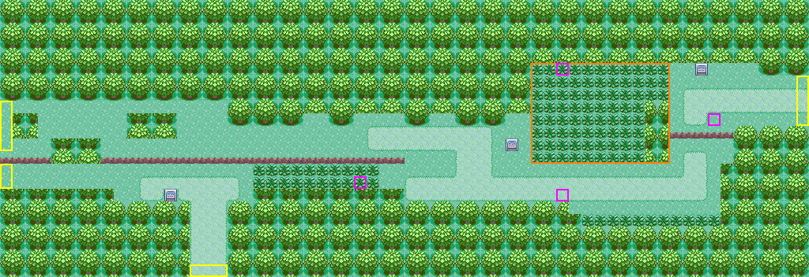
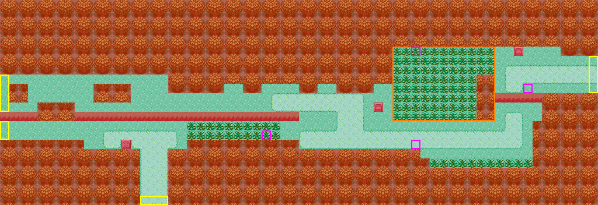
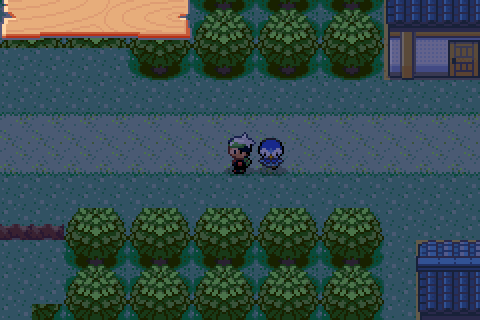

# Route 201: construction-ready design candidate (owner review)

**Status: CANDIDATE, design only.** No map file is built. It creates no map or section ID, encounter table, trainer, flag or script, and Sandgem's (#133) west edge stays closed. Building it needs the owner decisions at the end.

The render comes from [`route201-candidate.json`](route201-candidate.json), which [`make_route201_plan.py`](make_route201_plan.py) generates. [`verify_route201_plan.py`](verify_route201_plan.py) proves the collision and access rules below. Marks: yellow = exits, orange = reserved space, magenta = NPC slots. Art is the approved temporary in-repo General primary set used in Sandgem: grass, Route 101 dirt road, round trees, tall grass and ledges.

## Reference and method (source vs. this candidate)

- **Reference.** An original DPPt Route 201 overhead, 1024 × 347 px: [Elite Fourum upload](https://efour.b-cdn.net/uploads/default/original/3X/6/e/6e9fe789a5d327d17875ae0c01bddff4a1b8d9eb.jpeg). That is exactly **64 × 22 tiles of 16 px**, the original scale. It is used **only as a geometry reference**: it is not committed, and no pixels, tiles or palettes are taken from it.
- **Method.** Each 16 px tile was box-averaged and classified (sand path / light grass / tall grass / tree) with ImageMagick. Ambiguous areas were then read by eye on 3×-zoomed, gridded crops of the west, middle and north-east thirds. Every fill in the generator is one of those tile footprints. Departures are marked `DEVIATION` in the code and listed below.

## Footprints (x, y in metatiles; inclusive)

| Feature | Footprint | Reference |
| --- | --- | --- |
| West corridor (Lake Verity side) | grass 0–17 × 8–11; 18–41 × 10–11; tree-line notches on row 9 | same |
| Tree clumps in the corridor | 1–2 × 9–10; 10–13 × 9–10; 4–7 × 11–12 | first clump touches x 0 (see deviations) |
| **Long ledge** (`MB_JUMP_SOUTH`) | row 12, x 0–3 and 8–31 (clump at 4–7) | same, **no gap**: the walk-around is its east end, x 32–35 |
| Strip below the ledge | grass 0–19 × 13, 0–10 × 14, 9–10 × 15 | same |
| Lower path → **Twinleaf** | road 11–18 × 14–15; **3 wide**, 15–17 × 16–21 | same |
| Middle tall grass | 20–29 × 13–14 | same |
| Upper path + connector | road 29–38 × 10–11; 36–38 × 12–13 | same |
| Main eastern path | road 32–55 × 14–15 | same |
| **Big tall-grass patch** | 42–52 × 5–7 and 42–50 × 8–12, tree column 51–52 × 8–12 | same |
| **Short ledge** | row 10, x 53–57 | same |
| North-east clearing → **Sandgem** | grass 52–59 × 5–7 and 60–63 × 6–9, 53–57 × 8–9, 58–60 × 9; road 54–63 × 7–8, 54–55 × 8–9; trees 60–63 × 4–5 | path rows 7–8, ending at x 60 |
| Southern tall-grass strip | 46–56 × 17 | same |
| Signs | (13, 15), (40, 11), (55, 5) | same |
| Water | none | the reference shows no water on Route 201 |

**Original one-way design kept.** The short ledge blocks the path north to Sandgem. Walking east, the only way through is the big tall-grass patch (DPPt's first-encounter grass). Walking west, both ledges are one-way shortcuts down toward Twinleaf.

## Deviations (all minor, each for a stated reason)

1. **The path keeps its reference rows 7–8 but runs on from x 60 to the edge, and the edge is open on rows 6–9** (reference: 5–7). The 4 open rows meet Sandgem's built west verge (rows 10–13) exactly, road to road (Sandgem road rows 11–12), at an **even** offset (−4). An odd offset splits every 2 × 2 round tree across the seam, which the mGBA dry run showed ([`dry-run/`](dry-run/README.md)). Row 9 at x 58–60 opens to grass and the trees at x 60–63, rows 4–5 complete a 2 × 2, so no half-tree is created. Sandgem itself is unchanged.
2. **The lone tree at the west edge moves one tile in** (x 1–2), so the Lake Verity opening stays 4 rows wide (rows 8–11) for a future Lakefront map.
3. **The short-ledge verge reaches x 57**, so the ledge's east tile lands on grass. The engine never checks a ledge's landing tile (`PlayerJumpLedge`), so without this, that tile would jump the player onto a tree.

## Connection geometry

- **Seam image.** An actual mGBA screenshot from the [dry run](dry-run/README.md), with the player standing on Sandgem's west edge and Route 201 drawn in the camera strip to the left. The road continues and the round trees stay whole across the seam.
- **Offsets.** The engine moves the player by `pos -= connection->offset` (`fieldmap.c`) when crossing. Route 201's `right` connection to Sandgem gets **`offset: -4`**, and Sandgem's `left` connection to Route 201 gets **`offset: 4`**. They are exact negatives, so either direction lands on the same row: Route (63, y) ↔ Sandgem (0, y + 4). The dry run crossed rows 6, 8 and 9 in both directions and landed exactly.

| Edge | Route 201 tiles | Neighbour | State |
| --- | --- | --- | --- |
| East | x 63, rows 6–9 (road 7–8) | Sandgem west, rows 10–13 (road 11–12) | Sandgem built; **both** connection entries are added only after Route 201 is approved |
| South | y 21, x 15–17 | Twinleaf Town north edge | unapproved; closed |
| West (upper) | x 0, rows 8–11 | Lake Verity side | unapproved; closed |
| West (lower) | x 0, rows 13–14 | Lake Verity side, below the ledge | unapproved; closed |

## Collision and access proof

`python3 verify_route201_plan.py --self-test --sandgem-mapbin <#133 engine>/data/layouts/SandgemTown/map.bin`

The movement model is the engine's: collision 0 is walkable, and a south ledge is solid except when entered moving south, which jumps the player to the tile beyond. The Sandgem edge is read from #133's **built** `map.bin` (open rows `[10, 11, 12, 13]`).

**Positive (the candidate): 8/8 PASS**
- declared exit tiles are walkable;
- every walkable tile is reachable from the Sandgem exit;
- the Sandgem exit is reachable again from every walkable tile (no ledge trap);
- every exit reaches every other exit, in both directions;
- no walkable edge tile lies outside a declared exit;
- every ledge lands on walkable ground;
- the east seam matches Sandgem at offset −4 / +4;
- the east seam keeps the round trees in phase (check 7, added after the dry run).

**Negative (deliberately broken copies): 6/6 caught**

| Broken copy | Caught by |
| --- | --- |
| Trees over the big grass patch | access to Sandgem lost (checks 2 and 3) |
| Ledge landing on a tree | check 5 |
| Trees between the middle grass and the main path, leaving a one-way pocket below the long ledge | checks 2 and 3 |
| A stray gap in the east tree line | checks 4 and 6 |
| Offset −5 (odd) instead of −4 | checks 6 and 7 |
| A bottom-half tree on an even edge row | check 7 |

The previously reviewed plan (offset −5) **fails check 7**, as the dry-run screenshot shows.

This is a static proof of the plan. A throwaway **mGBA dry run** of this exact plan (no section, no events) already walked both seams, checked every closed edge and passed SAVE plus fresh Continue: 35/35 and 3/3 ([`dry-run/`](dry-run/README.md)). The permanent route gets the same `map_qa` acceptance on NORMAL and RELEASE after approval.

## Decisions requested from the owner

1. **Approve Route 201 as the next permanent map**, with this geometry (64 × 22) and the three deviations?
2. **Section ID:** Route 201 needs its own met-location section. That is Codex's next allocation from 217 upward and needs owner approval.
3. **Connection:** approve adding the reciprocal `left`/`right` connections (Route 201 −4, Sandgem +4). This touches Sandgem's `map.json`, which needs a new signed `HANDOFF_APPROVED` path.
4. **Twinleaf and both Lake Verity openings stay closed** until those areas are approved. (Yes / no.)
5. **Tall grass stays physical only** (no encounter table) until wild Pokémon are approved. (Yes / no.)

Building it after approval costs about 2.8 KB of layout (64 × 22 × 2 B) plus headers: **+2,948 B linked**, measured in the dry run. It reuses art that is already linked.
