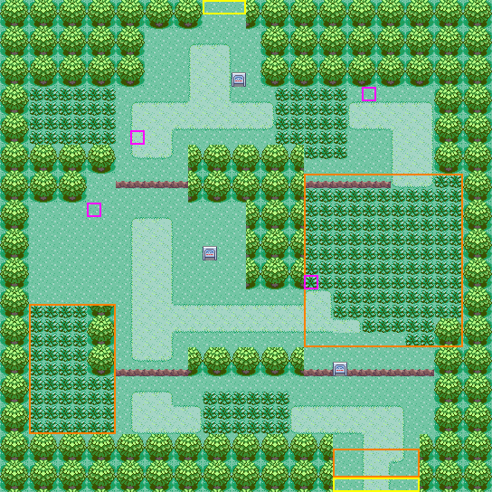
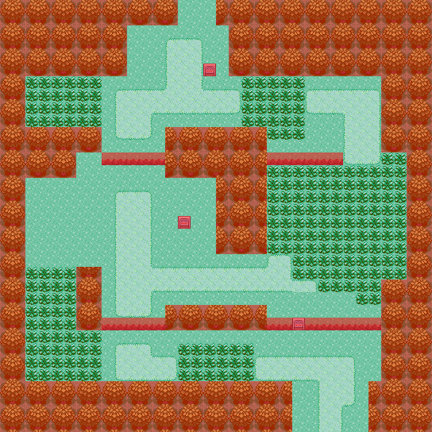
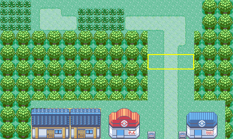

# Route 202: source-grounded design candidate (owner review)

**Status: CANDIDATE, design only.** Nothing is built. This creates no map, layout, map ID, section, connection, encounter table, NPC, flag, script or story content. Sandgem's built north edge (#133) stays closed. Building anything here needs the owner decisions in section 6.

| Candidate | Collision (red = solid) |
| --- | --- |
|  |  |

- **Files.** [`make_route202_plan.py`](make_route202_plan.py) generates [`route202-candidate.json`](route202-candidate.json) and renders it with the in-repo `scripts/sinnoh-placeholder-art.py`. Re-running it reproduces the JSON and all three PNGs byte for byte.
- **What the renders are.** They show the real Emerald metatiles the map would use, not emulator screenshots.
- **Marks.** Yellow = exits, orange = reserved space, magenta = NPC slots (positions of the DPPt trainers; no NPCs are proposed).

## 1. Source and method

- **Reference.** The original *Diamond/Pearl* overhead on Bulbapedia, [`File:Sinnoh_Route_202_DP.png`](https://bulbapedia.bulbagarden.net/wiki/File:Sinnoh_Route_202_DP.png).
  - 592 × 416 px, from `https://archives.bulbagarden.net/media/upload/3/39/Sinnoh_Route_202_DP.png`.
  - SHA-1 `deffab27d40d430ae1dedac8958d2929f78edcdd`, which matches the archive's own record (MediaWiki `list=allimages`, queried 2026-10-19).
  - Used **only as a geometry reference**: it is not committed, and no pixels, tiles or palettes are taken from it.
- **Cross-check.** The *Platinum* overhead [`File:Sinnoh_Route_202_Pt.png`](https://bulbapedia.bulbagarden.net/wiki/File:Sinnoh_Route_202_Pt.png), 610 × 452 px, from `https://archives.bulbagarden.net/media/upload/0/09/Sinnoh_Route_202_Pt.png`, SHA-1 `67674efa0c162974728964ba3a5988138fef0126` (matches).
  - It shows the same route: the north clearing, both upper sand paths, the central tree clump, both ledge lines, the east grass field, the south-west grass, the south sand paths and the 6-wide south exit.
  - It adds one tree on the clearing's west side and decorative rocks.
  - It also shows what DP crops: **Jubilife's 3-wide stairs come straight down onto the north clearing**, above the sand stub.
  - Its column phase is uncertain by about one tile on its west half, so it is used for topology only, not coordinates.
- **Measuring the grid.** `scripts/sinnoh-ref-grid.py` (branch `claude/twinleaf-build`; run from a scratch copy, not committed here) measured:
  - **across:** 16 px per tile;
  - **down:** 12.292 px per tile, because the render is foreshortened (the tree border repeats every 24.6 px = 2 tiles).

  Reference column `c` starts at x = 16c − 8 px; reference row `r` starts at y = 12.292r − 3.29 px. Every footprint was then read by eye on 4×-zoomed gridded crops.
- **Mapping.** Candidate x = c − 2 and y = r. The map is 34 × 34, covering reference columns 2–35 and rows 0–33.
- **What is exact and what is not.**
  - **Flat ground aligns with the grid:** sand edges, ledge strips and tall-grass edges. These are measured.
  - **Trees, signs and NPCs are 3D models** whose canopy or body is drawn up to a row above the tile they stand on. Their rows are **±1 tile**.
  - The render's crop includes neighbouring forest, so the DPPt map's own bounds are not visible. The candidate keeps all measured content plus a one-tree border.

Reference grid from the tool (`T` tree, `S` sand, `G` grass, `g` tall grass, `o` other; lowercase = mixed cell). Ledges and signs read as `o`, so they were read by eye. Selected rows, reference columns 0–37:
```
     01234567890123456789012345678901234567
  0  oTtTTTTTtTtTGGGGGGGGtTtTTTTTTTTTtTtTto
  3  TTTTTTTTTTTTGGGSSSGGTTTTTTTTTTTTTTTTTT
  7  TTTTggggggGSSSSSSSSSSgggggSSSSSSTTTTTT
 12  oTTTTTTTTTgooooTTTTTTTToooooogsgggTTTo
 16  oTTTGGGoooGSSSGGGGGTTTTgggggggggggTTTo
 22  oTTTggggTTGSSSSSSSSSSSSSSSSgggggotTTTo
 25  TTTTggggTTgooooTTTTTTTTgoTooooooTTTTTT
 28  oTTTggggggGSSSSSggggggSSSSSSSSGGTTTTTo
 33  TTTTTTTTTTTTTTTTTTTTTTTTTTGGGGGGTTTTTT
```

## 2. Footprints (x, y in metatiles; inclusive; map 34 × 34)

| Feature | Candidate | Reference (c, r) | Quality |
| --- | --- | --- | --- |
| North clearing | x 10–17, y 2–6 | c 12–19, r 0–6 | measured (see deviation 1 for rows 0–1) |
| **North exit → Jubilife** | grass x 14–16, y 0–1 | stairs above c 15–17 ±1 (Pt only) | deviation 1 |
| Sand stub | x 13–15, y 3–6 | c 15–17, r 3–6 | measured |
| Upper sand paths | x 9–18 and 24–29, y 7–8 | c 11–20 and 26–31, r 7–8 | measured |
| Path turns | west x 9–11, y 9–10; east x 27–29, y 9–12 | c 11–13 r 9–10; c 29–31 r 9–12 | measured |
| North tall grass | x 2–7, y 6–9; x 19–23, y 6–9 and 21–23, y 10 | c 4–9 r 6–9; c 21–25 r 6–9 and c 23–25 r 10 | measured |
| **Upper ledges** (`MB_JUMP_SOUTH`) | y 12: x 8–12 and 21–26 | r 12: c 10–14 and 23–28 | measured |
| East tall-grass field | x 21–31, y 12–23, stepped lower edge | c 23–33, r 12–23 | measured, ±1 on the steps |
| West sand path | x 9–11, y 15–24 | c 11–13, r 15–24 | measured |
| Cross path | y 21: x 9–22; y 22: x 9–24; plus x 21–22, y 20 | r 21–22, c 11–26 | measured |
| **Lower ledges** | y 25: x 8–12 and 21–29 (sign at 23) | r 25: c 10–14 and 23–31 | measured |
| South-west tall grass | x 2–5, y 21–25; x 2–7, y 26–29 | c 4–7 r 21–25; c 4–9 r 26–29 | measured |
| South tall grass | x 14–19, y 27–29 | c 16–21, r 27–29 | measured |
| South sand | bay x 9–13, y 27–29; path x 20–27, y 28–29 | c 11–15 and 22–29, r 27–29 | measured |
| **South exit → Sandgem** | clearing x 23–28, road x 25–27 → 25–26, y 30–33 | clearing c 26–31, sand c 27–29 | deviation 2 |
| Tree clumps | x 2–7 y 10–11 and 2–5 y 12–13; x 13–20 y 10–13 and 17–20 y 14–19; x 6–7 y 20–25; x 13–20 y 24–25 | c 4–9 r 11–12 and c 4–7 r 13–14; c 15–22 r 10–13 and c 19–22 r 14–19; c 8–9 r 20–25; c 15–22 r 24–25 | ±1 row (canopies); the west clump sits one row up so its trees are whole. Columns are exact, so clumps starting on an odd column show a half tree at that edge, as Route 201's do |
| Signs | (16, 5) route sign; (14, 17) trainer tips; (23, 25) route sign | (18, 5); (16, 17); (25, 26) | ±1 row; deviation 3 |
| Water | none | none | — |

**The DPPt zigzag is kept.** Walking north from Sandgem:
1. The lower ledges block the direct way, so you go west along the south strip.
2. North through the south-west tall grass.
3. East along the cross path.
4. North through the east grass field.
5. Up the east path turn (x 27–29, y 12, the only two-way link).
6. West along the upper paths to the clearing.

Walking south, all four ledges are one-way shortcuts.

**Deviations, each for a stated reason:**
1. **North rows 0–1 are open only on x 14–16** (reference: grass across c 12–19 up to Jubilife's wall).
   - Junction E requires exactly the 3 Jubilife stair columns to be open.
   - q = 14 (reference c 16, one column east of the sand stub's c 15) makes the Jubilife offset even (−30), so 2 × 2 trees stay whole across that future seam.
   - The stairs' column is itself ±1, since only the Platinum render shows them.
2. **The south clearing is drawn one column west** (x 23–28; the reference's c 26–31 would be x 24–29), and **the road's last two rows narrow to x 25–26.**
   - The reference opening is 6 wide like Sandgem's, but it starts on an even column and Sandgem's starts on an odd one. Meeting it unshifted would need an odd offset (±5), which splits every tree on the seam.
   - Shifting one column gives offset +4 / −4, with Sandgem's 2-wide road continued road to road.
3. **The south route sign sits in the ledge row** (reference: just below it).
   - `PlayerJumpLedge` never checks the landing tile, so a ledge tile above a sign would jump the player onto it.
   - The sign's row is ±1 anyway.

Not adopted: the item ball at reference (4, 8) and the trainers. Their positions are only marked as NPC slots.

## 3. Junction D: Sandgem Town ↔ Route 202 (no change to Sandgem now)



- **Sandgem's north edge, measured from the built layout.** `engine/data/layouts/SandgemTown/map.bin` is 32 × 28, from #133 commit `38100116`. Its u16 blocks were read as metatile = low 10 bits and collision = bits 10–11.
  - **Row 0 is open (collision 0) on exactly x 19–24:** grass 19–20, road 21–22 (metatiles 472/474), grass 23–24.
  - Every other column is a tree top half (468/469). The left half at x 18 and the right half at x 25 border the opening.
  - This confirms the older note "19–24, road 21–22" by measurement.
- **Route 202's south edge.** y 33 is open on x 23–28, with road on x 25–26.
- **Proposed connection:**
  - Route 202 `down` → Sandgem, offset **+4**;
  - Sandgem `up` → Route 202, offset **−4**.

  The engine moves the player by `pos −= offset`, so either direction lands on the same column: Route (x, 33) ↔ Sandgem (x − 4, 0).
- **Agreement with SINNOH_JUNCTIONS.md.** The junction-D table there gives Sandgem's offset as `21 − s`, where s is the Route 202 column meeting Sandgem x 21. Here s = 25, so 21 − 25 = −4.
- **Tree phase.**
  - The offset is even, so left and right halves line up.
  - Route 202's height (34) is even, so its bottom row is a bottom-half row facing Sandgem's top-half row 0.
  - The preview above stacks Route 202 rows 26–33 over Sandgem rows 0–9, built from the real metatiles of both: the plan's for Route 202 and the built `map.bin` for Sandgem ([`route202-sandgem-seam.json`](route202-sandgem-seam.json)). The road runs on and no tree is split.
- **Camera.**
  - From Sandgem, the buffer shows Route 202's southern 7 rows (y 27–33): sand paths, tall grass and the forest-framed clearing.
  - From Route 202, it shows Sandgem's northern 7 rows: the built road and roof tops.
- **Map size.** (34 + 15) × (34 + 14) = 2,352 ≤ 10,240.

## 4. Junction E: Route 202 ↔ Jubilife City (closed; Jubilife not built)

- **Route 202's side.** The north edge y 0 is open on exactly x 14–16.
- **Jubilife's side.** SINNOH_JUNCTIONS.md records its south stairs as x 44–46, from the earlier ~64 × 48 Jubilife reading. That reading is not re-measured here.
- **Proposed connection:**
  - Route 202 `up` → Jubilife, offset `q − 44` = **−30**;
  - Jubilife `down` → Route 202, offset **+30**.

  Both are even.
- **For whoever designs Jubilife.** Route 202's row 0 is a top-half tree row, so wherever trees meet this seam Jubilife's bottom row must be a bottom-half row: Jubilife's height must be even.
- **Until then.** The north tiles are a closed exit. The engine blocks the step, the same as Route 201's unbuilt edges.

## 5. Proof

`python3 -B verify_route202_plan.py --self-test` reads Sandgem's edge from the built `map.bin` and confirms it matches the recorded measurement. It uses Route 201's movement model: collision 0 is walkable, and a south ledge is solid except when entered moving south, which jumps the player one tile further.

**Positive (the candidate): 10/10 PASS**
- shape and the map-size limit;
- declared exit tiles are walkable;
- every walkable tile is reachable from the Sandgem exit;
- the Sandgem exit is reachable again from every walkable tile (no ledge pocket);
- south → north and north → south both connect;
- only the south and north edges are open;
- every ledge lands on walkable ground;
- the south seam matches Sandgem at +4 / −4;
- the south seam keeps trees whole, horizontally and vertically;
- the north opening is 3 wide with an even Jubilife offset.

**Negative (deliberately broken copies): 8/8 caught**

| Broken copy | Caught by |
| --- | --- |
| Trees over the east path turn (north section cut off) | checks 1 and 3 |
| Trees across the south-west tall grass (no walking route north) | checks 1 and 3 |
| Trees under the strip below the west ledge (jumping it leaves no way back) | check 2 |
| West ledge landing on a tree | check 5 |
| A gap in the west tree border | check 4 |
| Odd offset +5 | checks 6 and 7 |
| A top-half tree on the bottom row facing Sandgem | check 7 |
| North opening widened to 4 | checks 4 and 8 |

This is a static proof of the plan. After approval, the permanent route needs the usual `map_qa` acceptance in mGBA on NORMAL and RELEASE: both seam directions with the follower, closed edges, and Save → fresh Continue.

## 6. What stays out, and decisions requested from the owner

**Out of scope (owner or story):**
- encounters: the tall grass is physical only;
- the DPPt catching tutorial at the route's Sandgem end, marked reserved;
- trainers, items, sign text and music.

**Decisions:**
1. **Geometry.** Approve the 34 × 34 footprint with its 3 deviations, or ask for changes.
2. **Section ID (not owner-approved).** Route 202 needs a met-location section.
   - **Narrow decision:** approve one new append-only code for it, or name an existing code to reuse.
   - This candidate neither allocates nor names one.
   - Capacity is the scarce resource Codex tracks; see the merged Sinnoh origin-capacity measurement (#161).
3. **Connection.** Approve the reciprocal pair Sandgem `up` −4 ↔ Route 202 `down` +4. This opens Sandgem's closed north edge, which touches Sandgem's `map.json` and needs a signed `HANDOFF_APPROVED` for that protected path.
4. **North edge** stays closed until Jubilife exists. (Yes / no.)
5. **Art and music.** General + Dewford placeholders, as in Sandgem and Route 201. The music placeholder is to be chosen.

Once 1–3 are answered, the build follows the Route 201 pattern:
- writer script;
- same-source NORMAL/RELEASE builds;
- native and section tests;
- `map_qa` in mGBA.

Cost estimate: about 2.3 KB of layout (34 × 34 × 2 B), plus headers, reusing already-linked art.
