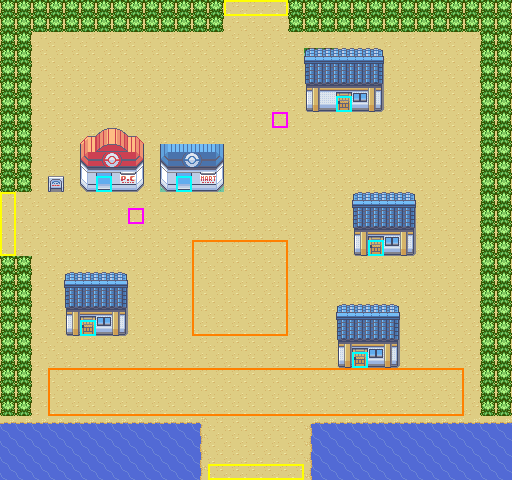
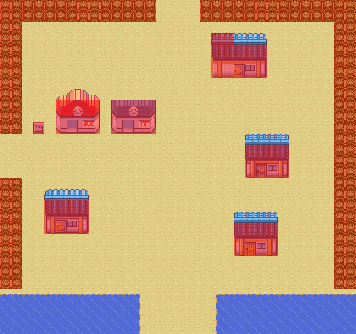
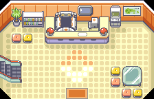
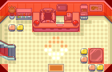

# Sandgem Town + Pokémon Center: first-slice design candidate

**Status: CANDIDATE for owner review (Claude, 2026-10-18).** Nothing here is approved. This candidate creates no map, layout, section, flag, script or saved ID. Tracker row `SN-T02` stays `UNDECIDED / PENDING / NOT_STARTED` until the owner decides. If the owner picks a different first slice, this work is reused for that slice; it is not argued for.

**A local DRY RUN already worked end to end**, from a scratch build with nothing applied to the repo; see [dry-run/README.md](dry-run/README.md). It covered:
- the real GBA build, with +2,242 B direct contribution;
- the door warp;
- the closed edges, the sea and the walls;
- the Pokémon Center door and heal;
- the follower;
- the Start menu;
- SAVE, then a fresh-process CONTINUE.

It also found the two process items the real PR needs: the protected `event_scripts.s` include lines, and the registry-check fix in #129.

The renders below come from the game's own data: real Emerald-build tilesets, and blocks copied from vanilla maps. They are produced by [`scripts/sinnoh-placeholder-art.py`](../../../../scripts/sinnoh-placeholder-art.py) from [`sandgem-town-candidate.json`](sandgem-town-candidate.json). They show what the map would look like in-game, and they are not emulator screenshots.

| Exterior with review marks | Collision view (red = solid) |
| --- | --- |
|  |  |

Marks: **yellow** = exits; **cyan** = doors; **magenta** = ambient NPC slots; **orange** = reserved event space.

## 1. Decisions requested from the owner

1. **Location:** Sandgem Town exterior plus its Pokémon Center 1F as the first permanent Sinnoh slice. *(Approve / choose another.)*
2. **Rough topology:**
   - footprint 32 × 30 metatiles;
   - exits west to Route 201, north to Route 202, and south to the Route 219 beach;
   - building positions as shown. *(Approve / adjust.)*
3. **Placeholder art:**
   - exterior: `gTileset_General + gTileset_Dewford`, a sandy coast that looks different from Averon's `General + Petalburg`;
   - interior: the shared vanilla `LAYOUT_POKEMON_CENTER_1F`;
   - NPCs: existing graphics.

   All of it is in-repo upstream art, labelled temporary. *(Approve / ask for other in-repo art.)*
4. **Section / met-location policy for "Sandgem Town":** the Codex lane recommends the smallest safe scheme. The pinned values 0..214 and `MAPSEC_NONE` stay put. *(Approve Codex's recommendation.)*

Once 1–4 are answered, Claude builds the real maps (section 6). Nothing below is a story decision.

## 2. Geography: what is preserved and what changes

| | Decision | Why |
| --- | --- | --- |
| Small sandy coastal town between Twinleaf (west), Jubilife (north) and the sea (south) | **PRESERVE** | This is Sandgem's recognisable identity and route position. |
| Pokémon Center and Poké Mart near the Route 201 entrance | **PRESERVE** | Arriving players heal first, and it is the slice's healing → Save → Continue acceptance path. |
| A research lab building | **PRESERVE as a RESERVED site** | The building stands, but who runs it, its interior and any scenes wait for the story. |
| Exact building positions; open sandy plaza instead of DPPt's fenced lots | **MODIFY** | GBA metatile footprints; a clear walking plaza; room for future events. |
| Beach to the south with a sand corridor to Route 219 between two stretches of sea | **MODIFY** | Keeps the walk-south-to-the-beach feel without needing Surf early. |
| The rival's house, the starter scene, Team Galactic and Platinum-only events | **NOT PORTED** | Averon's own story decides later; residence C is held neutral. |

## 3. Footprint, exits and connections

| Item | Coordinates (metatiles) | Notes |
| --- | --- | --- |
| Map size | 32 × 30 | Dewford is 20 × 20 and Saltmere is 40 × 34. About 2 × 3 GBA screens. |
| West exit → Route 201 | x 0–1, y 12–15 | 4-wide opening in the tree wall. Arrival path to the Pokémon Center. |
| North exit → Route 202 | x 14–17, y 0–1 | 4-wide opening. |
| South exit → Route 219 | x 13–18, y 29 | Sand corridor between the sea at x 0–12 and x 19–31. |
| Border | 2-tile tree wall (`579`, solid) | Map edges stay closed until the neighbouring routes exist, so there are no connections in the first slice. |

## 4. Buildings (exact vanilla stamps; collision, elevation and door behaviour are kept)

| Building | Position (x, y) and size | Door | Stamp source | First-slice status |
| --- | --- | --- | --- | --- |
| Pokémon Center | (5, 8), 4 × 4 | (6, 11) | `LAYOUT_DEWFORD_TOWN` 1,7,4,4 | **Built and warps to the interior** |
| Poké Mart | (10, 9), 4 × 3 | (11, 11) | `LAYOUT_MAUVILLE_CITY` 22,12,4,3 (lower three rows) | Exterior only, **no warp** yet |
| Research lab (**RESERVED**) | (19, 3), 5 × 4 | (21, 6) | `LAYOUT_DEWFORD_TOWN` 1,0,5,4 | Exterior only, no warp |
| House A | (22, 12), 4 × 4 | (23, 15) | `LAYOUT_DEWFORD_TOWN` 16,11,4,4 | Exterior only |
| House B | (4, 17), 4 × 4 | (5, 20) | same | Exterior only |
| Residence C (**RESERVED**) | (21, 19), 4 × 4 | (22, 22) | same | Exterior only |
| Town sign | (3, 11) | — | metatile `3` | Text: town name only |

Doors without an interior get no warp event. A door the player walks into does nothing until its interior is approved and built.

## 5. Movement, access and reserved spaces

- The whole interior of the town is open sand at elevation 3. Every door has a walkable tile directly south of it.
- The three exits connect through the plaza with no ledges or one-way traps.
- **Ambient NPC slots** (magenta) at (8, 13) and (17, 7) are off the main paths. Townsfolk and beach graphics are listed in the [placeholder manifest](../SINNOH_PLACEHOLDER_MANIFEST.csv). They get ordinary non-story lines.
- **Reserved event spaces** (orange):
  - the central plaza, x 12–17, y 15–20;
  - the beach strip, x 3–28, y 23–25.

  They stay empty and are marked `RESERVED_EVENT_SPACE`. Nothing is scripted there.

## 6. Pokémon Center interior and the build plan after approval

| 1F interior | Collision |
| --- | --- |
|  |  |

**Interior.** It reuses `LAYOUT_POKEMON_CENTER_1F` (14 × 9), exactly as Averon's Alderfield clinic does. That means no new interior art and no layout bytes.
- **Exit:** mats at (6, 8) and (7, 8) lead back to the door at (6, 11).
- **Nurse:** at (7, 2), using `Common_EventScript_PkmnCenterNurse`. Since #124 this script is safe in centres that never run `InitUnionRoom`.
- **Escalator** (1, 6): left without a warp, as in Averon's clinic. 2F link rooms are not part of the slice.

**Files, once approved.** All are new and append-only, sent in a normal reviewed PR. Map data is guarded, so the PR follows the protected-path process.
- **Exterior map:** `data/maps/SandgemTown/{map.json, scripts.inc}`, with `"region": "REGION_SINNOH"` so the merged #126 generator includes it.
- **Interior map:** `data/maps/SandgemTown_PokemonCenter_1F/{map.json, scripts.inc}`.
- **Layout:** `data/layouts/SandgemTown/{map.bin, border.bin}`. `map.bin` is written by `sinnoh-placeholder-art.py plan … --blockdata` from the approved plan, so the design and the built map are the same data.
- **Registration:** `layouts.json` and `map_groups.json` entries, in a Sinnoh map group.
- **Section:** whatever section ID the owner and Codex approve.

**Size estimate, to be measured at build.**
- Exterior blockdata: 32 × 30 × 2 = 1,920 B, plus an 8 B border and a few hundred bytes of headers, events and text.
- Interior: no new layout.
- Tilesets: Dewford, General, Building and PokemonCenter are all already linked, so 0 B.

**Test plan, real mGBA with controller input.**
- Walking and collisions, including the borders and the sea.
- Door out and back.
- Follower through the door.
- Nurse heal.
- Start menu.
- SAVE, then a fresh-process CONTINUE inside the centre and outside it.
- Normal and RELEASE builds, ROM growth, hashes, screenshots.
- Preflight, namespace and registry checks.
- Then `SN-T02` moves to `APPROVED / IN_PROGRESS → EMULATOR_PASS` only with that evidence, and `Gameplay` stays `DEFERRED`.

**Getting there for QA.** Until owner-approved Averon → Sinnoh travel exists, Sandgem is reached through a **disclosed DEV-fixture warp**. That is not a gameplay route.

## 7. Interfaces that belong to Codex or the owner (Claude will not edit them)

- **Section and met location for Sandgem, and region resolution.** `GetRegionForSectionId` is range-based, so a new section reports `REGION_HOENN` unless Codex's resolver says otherwise. That affects Town Map type, battle music, egg forms and regional evolutions.
- **Respawn and heal location.** Vanilla centres call `setrespawn HEAL_LOCATION_…` on entry. Until a Sandgem heal location exists, a whiteout in Sinnoh returns to the last Averon healer.
- **The Pokémon Center wall Town Map** at (11, 1) opens the current region's map, which is Hoenn's until a Sinnoh map and resolver exist. Options: accept that for the slice, or put a placeholder sign over it.
- **Fly:** Sandgem has no `sMapHealLocations` row. The merged #123 research covers the gap-row hazard.
