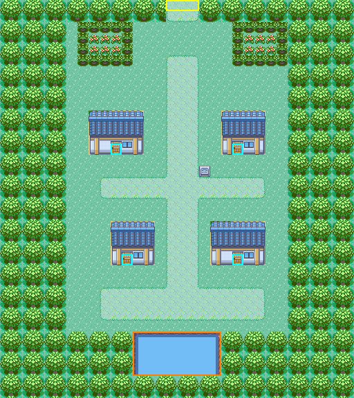
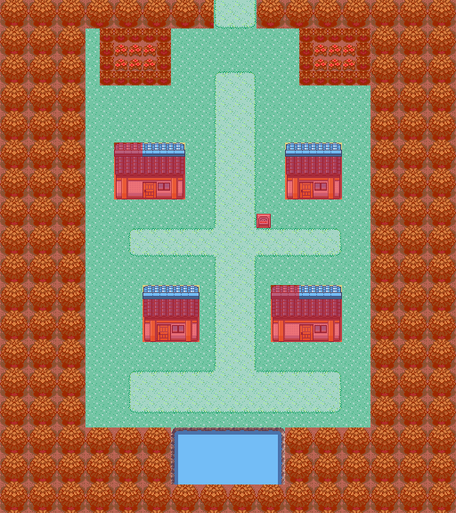
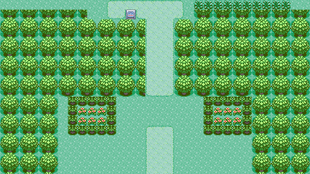

# Twinleaf Town: source-grounded design candidate (owner review)

**Status: CANDIDATE, design only.** Nothing is built. This creates no map, layout, map ID, section, connection, warp, NPC, flag, script or story content. Route 201's south edge (#150) stays closed. Building anything here needs the owner decisions in section 5.

| Candidate | Collision (red = solid) |
| --- | --- |
|  |  |

The renders come from [`twinleaf-candidate.json`](twinleaf-candidate.json), generated by [`make_twinleaf_plan.py`](make_twinleaf_plan.py) with the in-repo `scripts/sinnoh-placeholder-art.py`. They show the real Emerald metatiles the map would use; they are not emulator screenshots. Marks: yellow = exit, cyan = doors (no interiors), orange = reserved.

## 1. Source and method

- **Reference:** the original *Diamond/Pearl* overhead on Bulbapedia, [`File:Twinleaf_Town_DP.png`](https://bulbapedia.bulbagarden.net/wiki/File:Twinleaf_Town_DP.png). It is 510 × 475 px, from `https://archives.bulbagarden.net/media/upload/d/d3/Twinleaf_Town_DP.png`, and its SHA-1 `c160f5e1…06ce` matches the wiki's own record. It is used **only as a geometry reference**: it is not committed, and no pixels, tiles or palettes are taken from it.
- **Cross-check:** the *Platinum* overhead [`File:Twinleaf_Town_Pt.png`](https://bulbapedia.bulbagarden.net/wiki/File:Twinleaf_Town_Pt.png) (496 × 377) shows the same layout: four houses, two corner gardens, the crossroads sign and the pond.
- **Measuring the grid.** The render is top-down but **foreshortened**:
  - **across:** 16 px per tile. Sand speckle and the tree border repeat every 16 and 32 px, and the grid phase that minimises distinct 16 px blocks is x ≡ 7;
  - **down:** 12.33 px per tile. Sand speckle repeats every 12.33 px, and the trees, which are 2 tiles tall, every 24.67 px.
- **Classifying tiles.** Each cell (16 × 12.33 px) was classified by its majority colour: tree, sand, grass, water, building or fence. The vertical phase was chosen by maximum cell purity (y = 5.5 px). Column 0 starts 9 px left of the image.
- **Doors** come from the door-coloured pixel components: (10, 13), (21, 13), (11, 23) and (21, 23).
- **Uncertainty.** Each building's footprint is about ±1 tile, because 3D roofs and door models straddle tile edges. Roads, the pond and the tree border read cleanly.

The resulting reference grid (`T` tree, `S` sand, `G` grass, `W` water, `o`/`R` building, `f` fence; lowercase = mixed cell):
```
    012345678901234567890123456789012
  0 TTTTTTTTTTTTTTTSSSTTTTTTTTTTTTTTT
  2 TTTTTTTTfTftgTGGGGGTgtfTfTTTTTTTT
  5 ToToTotGgffgGGGSSSGGGgfgggtoToToT
  9 ToToTotGoooRRRGSSSGGooRGGGtoToToT
 16 TTTTTTTGGSSSSSSSSSSSSssSGGTTTTTTT
 20 TTTTTTTGGGooRGGSSSGooooRoGTTTTTTT
 26 TTTTTTTGGSSSSSSSSSSSSSSSGGTTTTTTT
 30 TTTTTTTTTTTTTwwwwwwwTTTTTTTTTTTTT
```
Selected rows are shown; the generator comments list every footprint.

## 2. Footprints (x, y in metatiles; inclusive; map 32 × 36)

| Feature | Candidate | Reference |
| --- | --- | --- |
| Tree border | x 0–5 and 26–31; rows 0–1 and 30–35 | 7 tiles each side (see deviation 1) |
| **North exit → Route 201** | road x 15–17, rows 0–1 | 3-wide sand stub through the tree band |
| Grass gap below the stub | x 15–17, rows 2–4 | same: the town path starts at row 5 |
| Main north–south path | x 15–17, rows 5–28 | same |
| Cross path at the sign | x 9–23, rows 16–17 | same |
| Southern path | x 9–23, rows 26–28 | same |
| Fenced gardens | x 7–11 and 21–25, rows 2–5 (shrub "fence", flowers inside; solid) | fenced flower beds, same footprint |
| North-west house (two-storey in DPPt) | 5 × 4 at (8, 10), door (10, 13) | door (10, 13) |
| North-east house | 4 × 4 at (20, 10), door (21, 13) | door (21, 13) |
| South-west house | 4 × 4 at (10, 20), door (11, 23) | door (11, 23) |
| South-east house (two-storey in DPPt) | 5 × 4 at (19, 20), door (21, 23) | door (21, 23) |
| Town sign | (18, 15) | at the crossroads |
| Pond | x 12–19, rows 30–33 (Surf only) | x 13–19, rows 30–33 |
| South / east / west exits | none | none in DPPt |

**Deviations, each for a stated reason:**
1. **The interior starts at x 6, one column wider on the left** (reference: x 7). The left border is then whole 2 × 2 trees. **Row 29 is grass the full width** (reference: only x 12–20), so the bottom tree band starts on an even row. Without these, the placeholder round trees would be cut in half.
2. **The pond is 8 wide (x 12–19)**, for the same tree-phase reason.
3. **The houses are placeholder Dewford stamps**: 5 × 4 for the two-storey houses, 4 × 4 for the small ones. The art has no fence, so shrubs stand in for the garden fences.

## 3. Junction B: Route 201 ↔ Twinleaf (no change to Route 201 now)



- **Proposed connection:** Route 201 `down` → Twinleaf, offset **0**; Twinleaf `up` → Route 201, offset **0**. Route 201's built south road (x 15–17, row 21) meets Twinleaf's north road (x 15–17, row 0) column for column.
- **Agreement with SINNOH_JUNCTIONS.md:** the junction table there gives offset `15 − t` with `t` = 15, so offset 0.
- **Tree phase:** offset 0 is even, so the trees stay whole. The preview above stacks Route 201 rows 14–21 over Twinleaf rows 0–9 from both plans' real metatiles; the road runs on and no tree is split.
- **Proof:** [`verify_twinleaf_plan.py`](verify_twinleaf_plan.py) `--self-test` checks:
  - shape;
  - the only open edge is north x 15–17;
  - every walkable tile and each door's front tile is reachable from the entrance;
  - the seam rows and tree parity against `../route201/route201-candidate.json`.

  It **passes**, and its 3 mutations are caught: a walled-off entrance, an odd offset of 1, and an extra west opening.

## 4. What stays out (owner or story decisions)

- **The houses:** whose they are, whether they have interiors, and any player-home or rival-home role. In DPPt this is the player's hometown, so all four are **UNASSIGNED** shells: no warps, no interiors, no NPCs.
- **The pond:** Surf access and the DPPt Odd Keystone spot are reserved; no item or event.
- **No south exit.** The donor port's Route 220 link is not adopted; DPPt has none.
- Music, NPCs, signs' text, flags, story beats and encounters: none.

## 5. Decisions requested from the owner

1. **Geometry:** approve the 32 × 36 footprint with its 3 deviations, or ask for changes.
2. **Permanent identities**, needed only when building:
   - a map in `gMapGroup_Sinnoh`, slot 3, after Sandgem, its Center and Route 201;
   - section `MAPSEC_TWINLEAF_TOWN` as the next append-only code, **218**. That would leave 34 spare codes, which is the scarce resource Codex tracks.

   Approve, or choose to reuse a code.
3. **Connection:** Route 201 `down` 0 ↔ Twinleaf `up` 0, which opens Route 201's closed south edge. This needs protected-path handoffs for Route 201's and Twinleaf's `map.json`.
4. **Buildings:** keep all four as closed shells for now (recommended), or name which ones get interiors.
5. **Placeholder art and music:** General + Dewford, as in Sandgem and Route 201; music placeholder to be chosen.

Once 1–3 are answered, Claude builds it using the Route 201 pattern:
- a writer script;
- same-source NORMAL/RELEASE builds;
- native and section tests;
- `map_qa` in mGBA: seams, closed edges, Save → fresh Continue.
