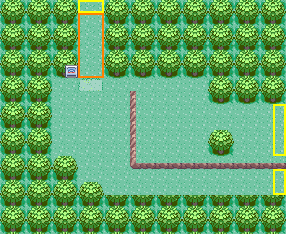
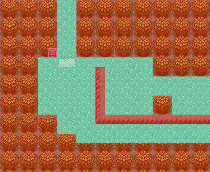
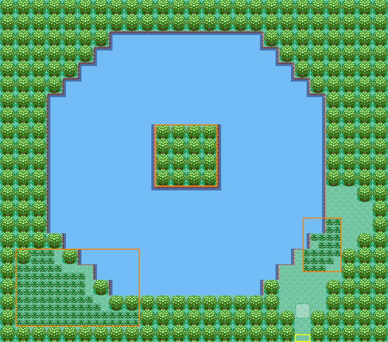
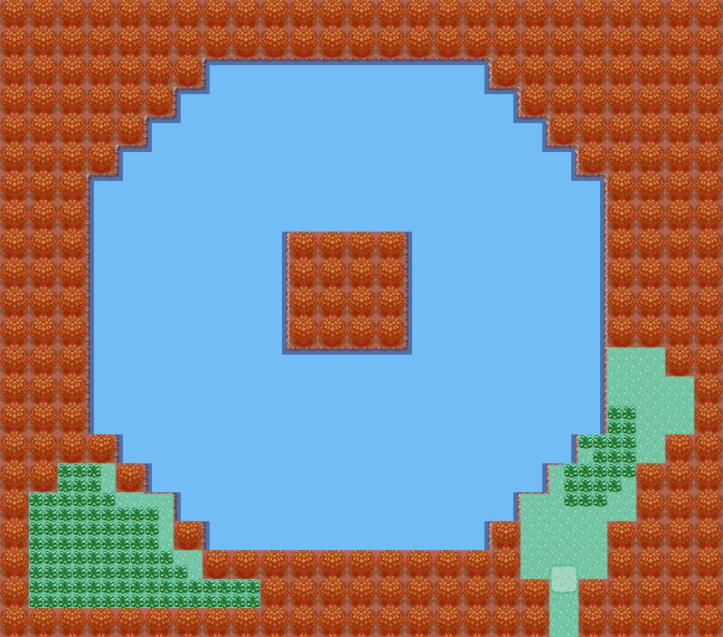
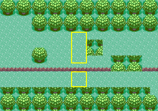
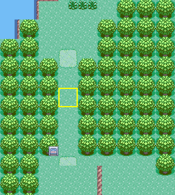

# Verity Lakefront + Lake Verity: source-grounded design candidate (owner review)

**Status: CANDIDATE, design only.** Nothing is built. This creates no map, layout, map ID, section, connection, warp, encounter table, NPC, flag, script or story content. Route 201's west edge (#150) stays closed. Building anything here needs the owner decisions in section 7.

| Verity Lakefront (22 × 18) | Collision (red = solid) |
| --- | --- |
|  |  |

| Lake Verity (50 × 44) | Collision (red = solid; blue water is Surf only) |
| --- | --- |
|  |  |

- **Files.** [`make_verity_plans.py`](make_verity_plans.py) generates both plan JSONs and the two seam previews, and renders all six PNGs with the in-repo `scripts/sinnoh-placeholder-art.py`. Re-running it reproduces every file byte for byte.
- **Marks.** Yellow = exits, orange = reserved space.
- **Water.** It is drawn with Route 102's pond pieces at **elevation 1**. On foot that is an elevation mismatch, so it can only be crossed with Surf. The collision render does not tint it, because its collision bit is 0.

## 1. Two maps, joined by a seam

**Choice: two maps, Verity Lakefront and Lake Verity, with a reciprocal north/south connection. There is no warp.**

- **DPPt treats them as two named locations, and the register has two rows** (SN-L04 Verity Lakefront, SN-L01 Lake Verity). Keeping two maps keeps the second name and leaves the section question open:
  - the owner can still give both maps one shared section to save a code;
  - one merged map could never be split back into two names.
- **Each stays small and simple:**
  - Lakefront: (22 + 15) × (18 + 14) = 1,184;
  - Lake: (50 + 15) × (44 + 14) = 3,770;
  - both well under 10,240.

  The lakefront alone carries the Route 201 seam. The lake carries only forest, water and its one exit.
- **A seam instead of a warp:**
  - no warp events or arrow-warp tiles are needed;
  - the follower simply walks across;
  - the same static seam proof as Route 201 applies.

  In DPPt the lake sits behind a shaded transition in the gap, probably a warp. The renders cannot show which, so a warp pair is the alternative if the owner prefers DPPt's fade (decision 3).

## 2. Sources and method

All files are Bulbapedia / Bulbagarden Archives overheads, used **only as geometry references**: not committed, and no pixels, tiles or palettes taken. URLs and SHA-1 come from the archive's MediaWiki API (`list=allimages`, 2026-10-19), and every downloaded file hashes to the archive's value.

| File | Size | SHA-1 | Role |
| --- | --- | --- | --- |
| [`Verity_Lakefront_DP.png`](https://bulbapedia.bulbagarden.net/wiki/File:Verity_Lakefront_DP.png), `https://archives.bulbagarden.net/media/upload/5/5f/Verity_Lakefront_DP.png` | 357 × 303 | `35c54f3e12a618fafde9bae5ece5ed0edb5e160c` | Lakefront footprints |
| [`Verity_Lakefront_Pt.png`](https://bulbapedia.bulbagarden.net/wiki/File:Verity_Lakefront_Pt.png), `https://archives.bulbagarden.net/media/upload/4/43/Verity_Lakefront_Pt.png` | 416 × 291 | `ea76aa15873f793f3a51ffca5a279675d48ea3ca` | cross-check: same gap, sign, sand patch, ledged plateau and trees; shows ~2 more columns east |
| [`Lake_Verity_DP.png`](https://bulbapedia.bulbagarden.net/wiki/File:Lake_Verity_DP.png), `https://archives.bulbagarden.net/media/upload/5/54/Lake_Verity_DP.png` | 864 × 648 | `252ca5ff68a3fde6468746aaf2a1ec6bd66b3ac0` | lake footprints |
| [`Lake_Verity_Pt.png`](https://bulbapedia.bulbagarden.net/wiki/File:Lake_Verity_Pt.png), `https://archives.bulbagarden.net/media/upload/b/be/Lake_Verity_Pt.png` | 864 × 648 | `67e378c629170508f5665a4dbc3fa488057bd046` | cross-check: identical geometry; snow and flower decoration only |
| [`Sinnoh_Route_201_DP.png`](https://bulbapedia.bulbagarden.net/wiki/File:Sinnoh_Route_201_DP.png), `https://archives.bulbagarden.net/media/upload/a/a6/Sinnoh_Route_201_DP.png` | 1040 × 320 | `3971fe10e63604404773e37e1378c1e39100cc63` | cross-check of Route 201's west end (junction C) |

**Measuring.**
- The renders are foreshortened: 16 px per tile across, 12.29–12.38 px down. `scripts/sinnoh-ref-grid.py` (branch `claude/twinleaf-build`, run from a scratch copy) measured the periods and phases.
- Every footprint was then read by eye on 4×-zoomed gridded crops.
- **Grids.**
  - Lakefront: column c at 16c − 8 px, row r at 12.375r − 2.38 px.
  - Lake: column c at 16c px, row r at 12.292r − 9.79 px.
- **Mapping.**
  - Lakefront: x = c − 1, y = r − 3.
  - Lake: x = c − 2, y = r − 3.

**What is exact and what is not.**
- **Measured:** flat ground, meaning paths, ledge strips, grass edges and shoreline cliffs.
- **±1 row:** trees and signs, which are 3D models drawn up to a row above their tiles. Tree clumps are placed on the 2 × 2 placeholder grid within that ±1, and columns are kept as measured.
- **Approximate:** both renders crop at forest, so neither map's DPPt bounds are visible. The candidates keep the measured content plus a tree border.

## 3. Footprints (x, y in metatiles; inclusive)

### Verity Lakefront (22 × 18)

| Feature | Candidate | Reference (c, r) | Quality |
| --- | --- | --- | --- |
| **North gap → Lake Verity** | x 6–7, y 0–5 | c 7–8, r 3–8; r 4–6 shaded as the lake transition | measured |
| Lakefront sign | (5, 5) | (6, 8) | ±1 row |
| Sand patch | x 6–7, y 6 | c 7–8, r 9 | measured |
| Top strip, open past the ledge cap | x 4–15, y 6 | c 5–16, r 9 | measured |
| Lower west ground (sign, gap, way to the lake) | x 4–9 y 7–11; x 6–9 y 12–13 | c 5–10 r 10–13; c 7–10 r 14–15 | measured; forest steps ±1 |
| Raised flower plateau | x 11–21, y 7–11 | c 12–22, r 10–14 | measured |
| **West-facing ledge** (`MB_JUMP_WEST`, metatile 133) | x 10, y 7–11; corner (10, 12) solid (141) | c 11, r 10–14; corner r 15 | measured |
| **South-facing ledge** (`MB_JUMP_SOUTH`) | y 12, x 11–21 | r 15: c 12–16, a tree at c 17–18, then c 19–22 | measured; tree moved up (below) |
| Plateau trees | x 16–19, y 6–7 | c 17–20, r 10–11 | ±1 row |
| Tree at the ledge | x 16–17, y 10–11 | c 17–18, r 14–15 | ±1 row |
| Lower strip | x 8–21, y 13–14 | c 9–22, r 16–17 | measured |
| **East edge → Route 201** | open y 8–11 and 13–14, ledge y 12 | open r 9–14 and 16–17, ledge r 15 | deviation 1 |

**Kept from DPPt.**
- The plateau continues Route 201's upper corridor. From it, both ledges are one-way drops to the lower ground that leads to the lake.
- Like the original, the top strip (y 6) runs past the ledge's cap, so the two levels also meet two-way there.
- Coming from Twinleaf along Route 201's lower strip, the lower ground is reached directly.

### Lake Verity (50 × 44)

| Feature | Candidate | Reference (c, r) | Quality |
| --- | --- | --- | --- |
| **Lake (Surf only)** | octagon: y 4–5 x 14–33; y 6–7 x 12–35; y 8–9 x 10–37; y 10–11 x 8–39; y 12–29 x 6–41; y 30–31 x 8–39; y 32–33 x 10–37; y 34–35 x 12–35; y 36–37 x 14–33 | shoreline cliffs stepping 2 columns per 2 rows, c 8–43, r 7–39 | measured; deviation 2 |
| **Central island and cavern** | x 20–27, y 16–23, solid trees, no warp | c 23–29 plus the cliff at c 22, r 19–26; cave mouth at c 26, r 22–23 | deviation 3 |
| South-east clearing (on foot) | x 36–47, y 24–40, stepped along the shore | c 38–49, r 27–43 | measured |
| South-east tall grass | x 39–43, y 28–34 (stepped) | c 41–45, r 31–37 | measured |
| Sand patch | x 38–39, y 39–40 | c 40–41, r 42–43 | measured |
| **South gap → Verity Lakefront** | x 38–39, y 41–43 | c 40–41, r 44–46 | measured |
| **South-west shore (Surf only)** | tall grass x 2–17, y 32–41; landing x 8–11, y 34 | c 4–19, r 35–44 | measured |
| North shore strip | none (tree line) | grass strip r 6, c 16–35, below the trees | deviation 2 |

## 4. Deviations, each for a stated reason

1. **The Lakefront's east edge is open on 4 rows above the ledge (y 8–11), not the ~6 measured.** The tree line x 16–21, y 6–7 closes the rest.
   - Route 201 is built (#150) with a 4-row west opening above its long ledge (rows 8–11), read from its own flat 16 px source.
   - The Bulbapedia renders show that corridor about 6 rows tall: about 6 at Route 201's west end in `Sinnoh_Route_201_DP.png`, and 6 at the Lakefront's east end. The two sources disagree.
   - The seam must follow the built map. The ledge row and the 2-row lower strip match exactly in both sources.
2. **The lake's edges are moved onto even rows.**
   - The lake's thin north shore strip (r 6) becomes tree line. It is reachable only by Surf in DPPt and carries nothing.
   - Its west shore step measured at r 32 moves one row, to y 30.
   - Its last water row (r 39) is doubled, as y 36–37. The row below it is canopy-hidden in the render.

   This puts every forest edge around the lake on the 2 × 2 tree grid.
3. **The island is 8 wide (x 20–27)**, against the measured 7 plus a cliff, so its placeholder trees are whole.
   - It is **neutral closed space**: solid, with no cave, warp or event.
   - In DPPt this is the legendary's cavern. Its content is reserved for the owner's story decisions.

## 5. Junctions

 

Both previews are built from the plans' real metatiles:
- [`route201-lakefront-seam.json`](route201-lakefront-seam.json): Lakefront x 12–21 beside Route 201 x 0–9, rows 4–17;
- [`lakefront-lake-seam.json`](lakefront-lake-seam.json): Lake rows 34–43 over Lakefront rows 0–9.

Roads, ledges and grass run on, and no tree is split.

### Junction C: Route 201 (west edge) ↔ Verity Lakefront (east edge); no change to Route 201 now

- **Route 201's side**, from `../route201/route201-candidate.json`: x 0 is open on rows 8–11 and 13–14, with its long ledge on row 12.
- **The Lakefront's side:** x 21 is open on y 8–11 and 13–14, with its south ledge on y 12. Row for row these are the same rows.
- **Proposed connection:**
  - Route 201 `left` → Lakefront, offset **0**;
  - Lakefront `right` → Route 201, offset **0**.

  Crossing lands on the same row: Lakefront (21, y) ↔ Route 201 (0, y). SINNOH_JUNCTIONS.md gives `8 − v` with v = 8, which is also 0.
- **Ledge continuity.** That document's hazard ("the Lakefront side must continue that ledge, or close row 12") is resolved by **continuing the ledge**.
  - Route 201's long ledge runs on as the Lakefront's south ledge, so both openings stay separate at the seam.
  - Every ledge drop stays one-way.
- **Tree phase.**
  - The offset is even, and the Lakefront's width (22) is even.
  - Its east column is right halves facing Route 201's left halves. Rows match top/bottom.
  - Row 15, just below the strip, is a bottom-half fringe on both sides. Route 201 already has it.
- **Camera.**
  - From the Lakefront, the buffer shows Route 201 x 0–7: the corridor, its ledge and its west tree clumps.
  - From Route 201, it shows the Lakefront's x 15–21: the plateau, the ledge tree and the strip.

### North seam: Verity Lakefront (north gap) ↔ Lake Verity (south gap)

- **The gaps.** Both are 2 wide, as measured: Lakefront x 6–7 and Lake x 38–39.
- **Proposed connection:**
  - Lakefront `up` → Lake, offset **−32**;
  - Lake `down` → Lakefront, offset **+32**.

  Crossing: Lakefront (x, 0) ↔ Lake (x + 32, 43).
- **Tree phase.**
  - The offsets are even.
  - The lake's height (44) is even, so its bottom row is bottom halves over the Lakefront's top-half row 0.
- **Camera.**
  - From the Lakefront, the buffer shows the lake's southern 7 rows at x 32–49: the corridor, the sand patch, the forest and one corner of water.
  - From the lake, it shows the Lakefront's northern 7 rows: the gap, the sign and the sand patch.
- **Edge coverage.** The Lakefront is narrower than the lake, so outside the shared span both edges are solid trees. The verifier checks this.

## 6. Proof

`python3 -B verify_verity_plans.py --self-test` uses the engine's movement:
- **On foot:** collision 0 at elevation 3 is walkable, and water is an elevation mismatch.
- **Ledges:** a south or west ledge jumps one tile further when entered in its direction, and is solid otherwise.
- **Surf:** land ↔ adjacent water, and water ↔ water. This follows `IsPlayerFacingSurfableFishableWater` and `CanStopSurfing`.

**Positive (the candidates): 16/16 PASS**

| Check | Meaning |
| --- | --- |
| L0 / V0 | shape and the map-size limit, both maps |
| L1–L4 | Lakefront exits are walkable; every tile is reachable on foot from Route 201 and can return (no ledge pocket); every exit reaches every other |
| L5 | the only open Lakefront edges are east (upper and lower) and north |
| L6 | every Lakefront ledge, south and west, lands on walkable ground |
| L7 | junction C matches Route 201's west edge tile for tile (walkable, ledge, tree halves) at an even offset |
| V1 | the lake's only open edge is its south gap |
| V2 | on foot, exactly the land outside the declared Surf-only shore is reachable; the shore is not |
| V3 | with Surf, every land and water tile is reachable from the gap and back |
| V4 | every water tile is Surf only: collision 0, elevation 1, pond water |
| V5 | the story-reserved island is closed: solid, no warps |
| N1 / N2 | the north seam has reciprocal even offsets, open faces open, and the trees stay whole |

**Negative (deliberately broken copies): 10/10 caught**

| Broken copy | Caught by |
| --- | --- |
| Odd junction C offset (+1) | L7 |
| A gap in the Lakefront's west border | L5 |
| The west-facing ledge lands on a tree | L6 |
| Trees across the gap (lake cut off) | L2, L3, L4 |
| The Lakefront's seam ledge removed (Route 201's ledge faces grass) | L5, L7 |
| A walkable tile on the island | V2, V3, V5 |
| Lake water at ground level (no Surf needed) | V2, V4 |
| A land path into the Surf-only shore | V2 |
| Trees across the lake's exit corridor | V2, V3 |
| Odd north-seam offsets (−31 / +31) | N1, N2 |

This is a static proof of the plans. After approval, each seam needs the usual `map_qa` acceptance in mGBA on NORMAL and RELEASE: both directions with the follower, closed edges, and Save → fresh Continue.

## 7. What stays out, and decisions requested from the owner

**Out of scope (owner or story):**
- the island's cavern and its legendary;
- the DPPt rival and Professor scenes at the lake entrance (the gap is marked reserved);
- encounters: all tall grass is physical only;
- when Surf becomes available: until then the lake and its south-west shore are simply unreachable water, as intended;
- music, NPCs and sign text.

**Decisions:**
1. **Geometry.** Approve both footprints with their 3 deviations, or ask for changes.
2. **Section IDs (not owner-approved).** The candidates neither allocate nor name any code. The narrow decision is one of:
   - (a) two new append-only codes, one per map;
   - (b) one new code shared by both maps (saves a code);
   - (c) reuse existing codes.

   Two map slots are also needed when building; their allocation stays with the owner and Codex.
3. **Lakefront ↔ Lake link.** Seam (this candidate) or a DPPt-style warp pair.
4. **Route 201 connection.** Approve the reciprocal `left`/`right` pair at offset 0. It opens both of Route 201's west openings at once, which touches Route 201's `map.json` and needs a signed `HANDOFF_APPROVED` for that protected path.
5. **Art and music.** General + Dewford placeholders, as in Route 201, Sandgem and Twinleaf. The music placeholder is to be chosen.
